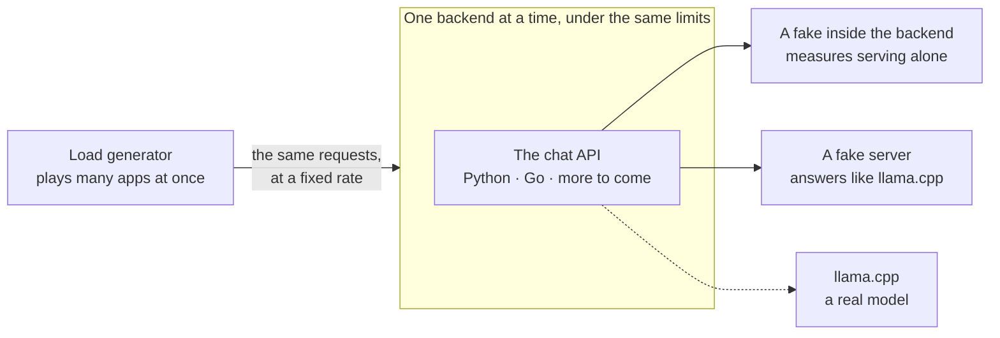

# api-langs-bench

[](https://github.com/fkuhne/api-langs-bench/actions/workflows/ci.yml)

**Does the language you write an AI backend in matter? This repository measures it.**

The same chat backend is written in several programming languages. Each one gets the same requests, at the same rate, under the same CPU and memory limits, on the same machine. Every number can be traced to the run that made it, and every run can be repeated with one command.

Python and Go are here today. Rust, Java, JavaScript and C++ follow.

## The idea

An AI backend has a simple job. An app sends it a chat request, it asks a language model, and it passes the answer back, usually piece by piece as the model writes it.

Measuring that job has a trap. A model takes seconds to answer, and a backend adds milliseconds. Put a real model behind it, and every language looks the same.

So most runs here replace the model with a **fake that keeps a timetable**: the first piece of the answer at 50 ms, then one more every 10 ms, the same text every time. A stream of 20 pieces is then due to end at exactly 240 ms. Anything a run measures beyond 240 ms is the backend's own doing.



## A first look

The first numbers, to show what a result looks like. Each backend streamed 20 pieces of text, due to end at 240 ms, from the fake inside it, with 1 CPU and 512 MiB. The cell is the median latency over three runs of 30 s.

| Requests a second | 100 | 500 | 1,000 | 2,000 |
|---|---|---|---|---|
| Python, FastAPI | 243.2 ms | fell behind | fell behind | fell behind |
| Go, `net/http` | 240.9 ms | 240.8 ms | 240.9 ms | 241.0 ms |
| Go, Gin | 241.0 ms | 240.8 ms | 240.9 ms | 241.3 ms |

- **Both Go servers added about 1 ms** to each stream, all the way to 2,000 requests a second.
- **Python added about 3 ms at 100 requests a second,** and answered about 300 streams a second at most. Past that, requests queued.

**Read these as a preview, not a verdict.** They come from one development machine that runs Docker in a VM, under limits and rates that are still provisional, and Python runs as one process here. The measured report comes later, from native Linux. The full table, its 36 runs and its caveats are in [the runner's notes](docs/runner.md#the-first-numbers-on-2026-11-10-on-a-core-i7-12850hx).

## Try it

You need Docker with Compose, and nothing else. Every command is the same on Linux, macOS and Windows.

```text
git clone https://github.com/fkuhne/api-langs-bench
cd api-langs-bench
docker compose up -d --wait
```

That builds and starts the three backends and the fake server. Ask one for a stream, here from a POSIX shell or cmd:

```text
curl -N http://127.0.0.1:8002/api/chat/stream -H "Content-Type: application/json" -d "{\"messages\": [{\"role\": \"user\", \"content\": \"Hi\"}], \"parameters\": {\"max_tokens\": 5}}"
```

```text
event: token
data: {"text":"A"}

event: token
data: {"text":" backend"}
…
event: done
data: {"model":"fake","finish_reason":"length","usage":{"prompt_tokens":1,"completion_tokens":5,"total_tokens":6}}
```

Then check that every backend does the same work, and measure them:

| Command | What it does | Time |
|---|---|---|
| `docker compose run --rm conformance` | Sends every backend the same requests, alone and through the fake server, and checks each answer and each fake's timing: 627 checks | About 3 minutes, once its images are built |
| `docker compose run --rm runner --passes 1` | Sends each backend the workload at 100, 500, 1,000 and 2,000 requests a second, saves each run in [`runs/`](runs/README.md), and prints a table | About 8 minutes |
| `docker compose up -d --wait llama-cpp` | Starts llama.cpp with a small real model, to put behind a backend ([how](docs/llama-cpp.md)) | About 80 s the first time, which downloads 533 MB |
| `docker compose down` | Stops everything | |

Port 8001 is Python on FastAPI, 8002 is Go on `net/http`, and 8003 is Go on Gin.

## What makes it a fair comparison

- **One contract.** Every backend implements [the same API](contract/README.md), taken from [ai-bootstrap](https://github.com/fkuhne/ai-bootstrap): a chat answer, whole or streamed, with its errors.
- **Proof that they do the same work.** [The conformance suite](docs/conformance.md) holds every backend to the contract, and every fake to its timetable.
- **Code a competent engineer would write.** Each backend follows its ecosystem's documented production set-up, and none is tuned alone to win ([how each is set up](docs/backends.md)).
- **The same limits,** and one backend running at a time.
- **Load that doesn't wait.** Requests arrive at a fixed rate whatever the backend does, as real users do. A tool that waits for each answer hides the slow moments ([why it matters](docs/benchmarking.md#measuring-latency-without-fooling-ourselves)).
- **Helpers that are measured first.** The load generator and the fake server are each shown to be far from their own limits.
- **Runs that are never edited.** Each is saved once, with its commit, its versions, its settings and its machine. Numbers from different machines are never compared.
- **Every choice written down,** with what was rejected and what's still unproven ([the decision records](spec/decisions/README.md)).

## Where it stands

| Phase | What | Status |
|---|---|---|
| 1 | A thin slice: the contract, three backends, the conformance suite, a first runner, CI, the first numbers | Done |
| 2 | The local upstreams: a fake server, each backend's client for it, and llama.cpp | Under way: every backend [calls](docs/backends.md#the-upstream-client) the [fake server](docs/fake-server.md) or [llama.cpp](docs/llama-cpp.md). Runs against them come next |
| 3 | Measuring: the fairness rules, more workloads, how streams behave, memory and CPU | Planned |
| 4 | A remote upstream: an imitation behind a network emulator, and Ollama Cloud | Planned |
| 5 | Conversations stored in PostgreSQL | Planned |
| 6 | A web UI, and the first report | Planned |

The steps, in order, are in [the plan](spec/plan.md).

## Find your way

- **[A guide to the notes](docs/README.md):** which page holds what, and every term explained, from "upstream" to "p99".
- **[The runner](docs/runner.md):** how a measurement is made, and the numbers so far.
- **[The contract](contract/README.md):** what every backend must do.
- **[llama.cpp](docs/llama-cpp.md):** a real model behind any backend, in one command.
- **[The product spec](spec/product.md):** what this project covers, and what it leaves out.
- **[Benchmarking an AI backend](docs/benchmarking.md):** what others have measured, and how, each claim with its source.

The code is in [`backends/`](backends/), [`fake-server/`](fake-server/) and [`bench/`](bench/), the evaluation tool.

## How it's worked on

From a spec, one plan step at a time, with a record for each decision, in the open. [`AGENTS.md`](AGENTS.md) gives the method to the coding agents that help build it.

## Licence

MIT No Attribution: copy any part freely, no notice needed ([`LICENSE`](LICENSE)).
